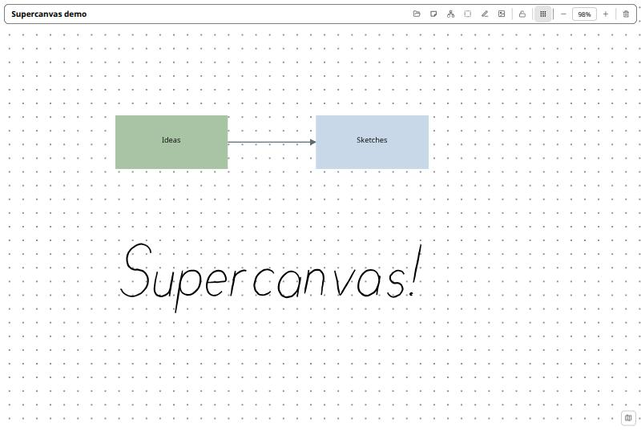

# Supercanvas



An infinite canvas for the **Supernote Nomad**: notes, shapes, connections, simple mind maps and handwriting,
all on one endless page. It writes with Supernote's own real-time pen engine, so ink keeps up with the pen.

No sync, no accounts. A canvas is a single `.supercanvas` file in a folder you choose, saved a moment after
every change.

## Tools

One toolbar runs across the top: the canvas's name on the left (tap it for your canvases), the tools on the
right. Tools with options (the pen, shapes) open a strip down the left side; tap the tool again, or the
strip's ✕, to put it away.

| Tool | What it does |
| --- | --- |
| **Canvases** | Open, create, rename and delete canvases; folders; **Export PNG / PDF** of the whole canvas; screen **Orientation**; **About**. Also opened by tapping the canvas's name. |
| **Shapes** | Drag onto the canvas to drop a note: text, post-it, rounded, rectangle, ellipse, triangle. Tap to choose the shape. Double-tap a note to type (Markdown with live preview). |
| **Mind map** | Drops a mind-map root. Long-press a node for *Add a child / parent / sibling*. |
| **Select** | Draw a lasso around notes and ink to select them, then drag inside the selection to move it, or tap **Delete**. |
| **Pen** | Pen, highlighter and eraser; colors; three widths; undo/redo; optional finger drawing; clear ink. |
| **Picture** | Adds a picture from the device (stored inside the canvas file). |
| **Lock · Background · Zoom · Clear** | Lock the canvas to navigation only, switch dots / lines / blank, zoom, clear everything. |

Also on the canvas:

- **Connections:** drag a note onto another to connect them; tap a line to bend it, long-press for its options.
- **Regions** group notes; long-press for menus (colors, borders, text alignment, and more).
- **Navigation:** one finger pans, two fingers pinch to zoom; a minimap (bottom right, closed until you open
  it). Your palm is ignored while the pen is near.
- **Orientation:** follow the system, turn with the device, or hold portrait or landscape (either way up),
  from the Canvases panel or Ctrl+Shift+R.

## Install

1. On the Nomad, turn on sideloading: **Settings → Security & Privacy → Sideloading** (wording may vary by firmware).
2. Download `supercanvas-1.0-beta.2.apk` from the [Releases](../../releases) page, copy it to the Nomad
   (USB, or download it there in the browser) and open it to install.
3. Open **Supercanvas**, choose (or make) a folder for your canvases, and allow access to storage when asked.

Or, with USB debugging on: `adb install -r supercanvas-1.0-beta.2.apk`.

## Notes

- **Beta.** Tested on a Supernote Nomad only.
- **Live ink uses undocumented Supernote internals** (its handwriting service). A firmware update could change
  them; if it's not available, Supercanvas falls back to its own, slower ink rather than failing.
- The APK is signed with a debug key, so installing a later build may need the previous one uninstalled first.

## Building

Needs Node.js and the Android SDK (with Java 17).

```bash
npm install
npm run apk        # builds the web app and the APK → dist/supercanvas.apk
npm run deploy     # installs it over USB (adb)
```

`npm run dev` runs the canvas in a desktop browser (with browser storage instead of files) for working on it.

## License

[MIT](LICENSE)
